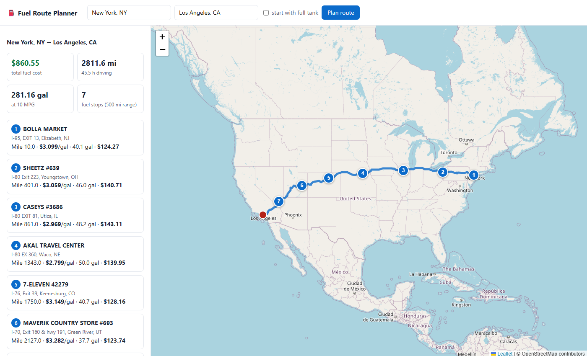
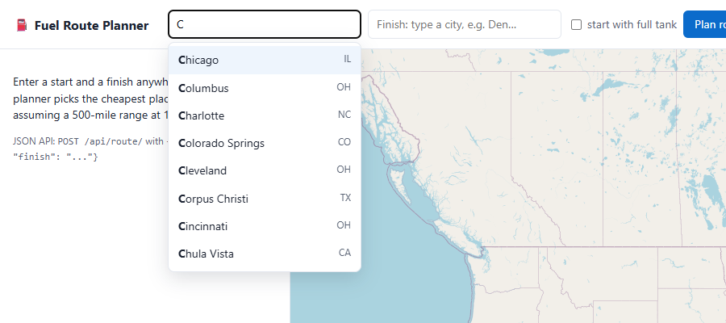

# Fuel Route Optimizer API

A Django REST API that takes a start and a finish location in the USA and returns:

* the driving route, as GeoJSON plus an interactive map page,
* the **cost-optimal fuel stops** along it, using the provided fuel price list, for a vehicle with a **500-mile range**,
* the **total fuel cost** at **10 MPG**.

It makes **one routing API call per trip**, and none at all for a repeated trip, because the route is cached. Locally the planner adds about 25 ms; the rest of the response time is the routing provider.

```
POST /api/route/   {"start": "New York, NY", "finish": "Los Angeles, CA"}

→ 2,811.6 mi · 7 fuel stops · 281.16 gal · $860.55 total · 1 external API call
```



---

## Quick start

Requires Python 3.12+ (tested on 3.13) and a free [OpenRouteService API key](https://openrouteservice.org/dev/#/signup).

```bash
python -m venv .venv
.venv\Scripts\activate            # macOS/Linux: source .venv/bin/activate
pip install -r requirements.txt

cp .env.example .env              # then set OPENROUTESERVICE_API_KEY=...
python manage.py migrate
python manage.py load_stations    # loads 6,616 pre-geocoded stations (~1 s)
python manage.py runserver
```

* API: `http://127.0.0.1:8000/api/route/`
* Map UI: `http://127.0.0.1:8000/` (redirects to `/api/route/map/`). The start and finish boxes suggest US cities as you type.
* CLI: `python manage.py plan_route "Chicago, IL" "Denver, CO"`
* Postman: import `postman_collection.json` (15 ready-made requests, including error cases)
* Tests: `python manage.py test` (37 tests, no network needed; the routing API is mocked)
* Lint: `pip install -r requirements-dev.txt && ruff check . && ruff format --check .`

---

## API

### `POST /api/route/` (or `GET /api/route/?start=...&finish=...`)

| Field | Type | Description |
|---|---|---|
| `start`, `finish` | string, required | `"City, ST"`, `"City, State"`, `"lat,lon"` or a US street address |
| `start_full` | bool, default `false` | The vehicle leaves with a full tank. The default is empty, so every mile is paid for. |
| `stop_cost` | number, default `5` | Overhead in USD per fuel stop used while optimizing (see [below](#why-a-stop-cost)). `0` gives the strictly cheapest fuel plan. |

**Response** (abridged):

```json
{
  "start":  {"query": "Chicago, IL", "label": "Chicago, IL", "lat": 41.837045, "lon": -87.684939, "resolved_by": "gazetteer"},
  "finish": {"query": "Denver, CO",  "label": "Denver, CO",  "lat": 39.76185,  "lon": -104.881105, "resolved_by": "gazetteer"},
  "route": {
    "distance_miles": 1000.7,
    "duration_hours": 15.93,
    "geometry": {"type": "LineString", "coordinates": [[-87.68494, 41.83705], "..."]}
  },
  "vehicle": {"range_miles": 500.0, "miles_per_gallon": 10.0, "starts_with_full_tank": false},
  "fuel_summary": {
    "number_of_stops": 3,
    "total_gallons": 100.07,
    "total_fuel_cost": 291.89,
    "average_price_per_gallon": 2.917,
    "stop_cost_used": 5.0,
    "currency": "USD"
  },
  "fuel_stops": [
    {
      "stop_number": 1, "opis_id": 70180, "name": "Gulf", "address": "SR-83",
      "city": "Bensenville", "state": "IL", "lat": 41.958011, "lon": -87.943825,
      "price_per_gallon": 3.059, "mile_marker": 15.0, "distance_from_route_miles": 6.2,
      "gallons_purchased": 20.2, "cost": 61.79
    },
    {"stop_number": 2, "name": "KUM & GO #0267", "city": "Tipton", "state": "IA", "price_per_gallon": 2.982, "mile_marker": 202.0, "gallons_purchased": 35.6, "cost": 106.17},
    {"stop_number": 3, "name": "AKAL TRAVEL CENTER", "city": "Waco", "state": "NE", "price_per_gallon": 2.799, "mile_marker": 558.0, "gallons_purchased": 44.27, "cost": 123.92}
  ],
  "notes": [],
  "meta": {"stations_in_corridor": 202, "corridor_miles": 10.0, "route_cached": false, "external_api_calls": 1, "response_time_ms": 1707.0},
  "map_url": "http://127.0.0.1:8000/api/route/map/?start=Chicago%2C+IL&finish=Denver%2C+CO"
}
```

Each stop's `gallons_purchased` and `cost` show exactly how much to buy there, and `total_fuel_cost` is their sum. `map_url` opens the interactive map for the same trip. It is served from the cache, so it costs no extra API call.

**Errors** always have the shape `{"error": {"code": ..., "message": ...}}`:

| HTTP | `code` | When |
|---|---|---|
| 400 | `invalid_request`, `same_location` | Missing or invalid fields; start equals finish |
| 422 | `outside_usa` | A location outside the USA (checked against the Census US boundary polygon) |
| 422 | `invalid_location`, `no_route` | The location can't be found; no drivable route (e.g. Honolulu → Denver) |
| 422 | `route_not_fuelable` | A stretch of the route longer than 500 mi has no listed station |
| 502 / 503 | `routing_unavailable`, `routing_rate_limited`, ... | The routing provider is down, rate-limited or misconfigured |

### `GET /api/places/?q=chi`: city autocomplete

Suggestions for "what the user has typed so far", most populous first. They come from the bundled gazetteer, so there are no external calls and each lookup takes under 5 ms.

| Query | Top results |
|---|---|
| `C` | Chicago, IL · Columbus, OH · Charlotte, NC · Colorado Springs, CO · ... |
| `chi` | Chicago, IL · Chico, CA · Chino, CA · ... |
| `spring, mo` | Springfield, MO · Blue Springs, MO · ... (text after the comma filters by state code or name) |
| `st lo` / `ft wo` | St. Louis, MO / Fort Worth, TX (abbreviations understood) |
| `vegas` | Las Vegas, NV · North Las Vegas, NV (later words match too) |

```json
{"query": "den", "results": [{"label": "Denver, CO", "name": "Denver", "state": "CO", "lat": 39.76185, "lon": -104.881105, "population": 729019}, "..."]}
```

Every suggested `label` can be passed straight to `/api/route/` as `start` or `finish`, and it resolves offline. The map page uses this endpoint for its type-ahead boxes.



`GET /api/health/` returns `{"status": "ok", "stations_loaded": 6616}`.

---

## How it works

```
"City, ST" ──► offline gazetteer ─┐
"lat,lon"  ──► parsed directly ───┼──► OpenRouteService directions (1 call, cached)
address    ──► ORS geocoder ──────┘                │
                                                   ▼
                              resample route every 1 mi (numpy)
                                                   │
                     in-memory grid index of 6,616 stations ──► stations within 10 mi of the route
                                                   │
                       exact dynamic program ──► where to stop and how much to buy
```

### 1. Few external calls

| Step | External calls |
|---|---|
| Geocode `"City, ST"` / `"lat,lon"` input, city autocomplete | **0**: bundled US Census gazetteer (31,796 names, with GeoNames population for ranking) |
| Geocode the 6,616 fuel stations | **0**: done once offline, results committed to the repo |
| Route | **1**: OpenRouteService `directions/driving-car/geojson` |
| Repeat trip, other `stop_cost` / `start_full`, map page | **0**: route and corridor are cached on disk |
| Free-form street address | +1 per address (ORS geocoder), so 2–3 calls in total |

### 2. Geocoding the price list offline

The CSV has no coordinates. Calling a geocoder for ~6,700 stations would be slow and rate-limited, so `manage.py build_datasets` matches each station's city and state against public gazetteers, in this order:

1. US Census places
2. Census county subdivisions
3. GeoNames populated places

Matching uses normalized names: `St.` → `Saint`, `Mc Calla` = `McCalla`, accents folded, Census suffixes like "city" or "CDP" stripped.

* **99.8%** of US rows match. 15 rows in tiny unlisted places are skipped and logged.
* 620 Canadian rows are dropped, because routes are US-only.
* 900 duplicate OPIS IDs (e.g. "PILOT #1243" vs "PILOT TRAVEL CENTER #1243") are merged, keeping the lowest price.

The output (`routing/data/stations_geocoded.csv`) is committed, so nobody needs to run this step again.

### 3. Finding the stations along the route

At startup, stations are loaded into numpy arrays and bucketed into a 0.25° grid. The route polyline is resampled every mile. Only the grid cells near the route are examined, and the distances are computed with one vectorized operation. A 2,800-mile route takes about 15 ms. Each candidate station gets a *mile marker* (where along the route it is reached) and its distance from the route.

### 4. Choosing the stops: an exact dynamic program

This is the classic *gas station problem*. The implementation follows Khuller, Malekian & Mestre, *"To fill or not to fill: the gas station problem"* (2007). In an optimal plan, at every stop you either **fill the tank** or **buy just enough to reach the next stop**. That means the fuel on arrival is always `0` or `range − distance from the previous stop`, which makes an exact DP fast: about 10 ms for 450 corridor stations. Fuel is tracked in miles of range and converted to gallons at 10 MPG.

`routing/tests/test_optimizer.py` checks the DP against an exhaustive brute-force solver on 600 random instances.

### Why a stop cost?

The mathematically cheapest plan will happily stop for 0.2 gallons to save a fraction of a cent. On Chicago → Denver, `stop_cost=0` gives **7 stops for $291.00**, one of them buying 0.2 gal for $0.60. The default `stop_cost=5` gives **3 stops for $291.89**: $0.89 more, and four fewer stops. The stop cost only affects *where* the plan stops. `total_fuel_cost` is always pure fuel. Send `"stop_cost": 0` for the strict optimum.

---

## Assumptions

* **The tank starts empty** (default). The first fill-up is at a station within 50 miles of the origin, and the fuel for those first miles is bought there, so `total_gallons = distance / 10`. Set `start_full: true` to start with a full tank, in which case only fuel bought on the way is counted and a trip under 500 miles needs no stops.
* A station counts as "on the route" if it is within **10 miles** of it (`CORRIDOR_MILES`). Station positions are city-level, since the CSV has no coordinates. Most stops are at interstate exits, so the actual detour is small.
* The vehicle can drive the full 500 miles on a tank (no safety reserve). Range, MPG, corridor width and stop cost can all be changed in `.env`.
* If the price list has no station near the origin, the vehicle is assumed to reach the first listed station, and the response explains this in `notes`. The dataset has very few California stations (8), so this happens for trips starting in Los Angeles.

## Performance

Measured locally (Windows, Python 3.13):

| Request | Time |
|---|---|
| New route (dominated by the OpenRouteService call) | typically 1.3–2.6 s; the first call after idle can take longer |
| Same trip again / different `stop_cost` / map page | **45–70 ms** |
| Local compute only (corridor + optimizer) | ~25 ms |

The station index and gazetteer are built when the WSGI app boots, so the first request is not slower than the rest.

## Project layout

```
fuel_route/                 Django project (settings read from .env)
routing/
  services/
    planner.py              orchestration + route cache
    optimizer.py            exact DP for fuel stops (pure, unit-tested)
    stations.py             in-memory grid index + corridor search
    geo.py                  vectorized haversine, resampling, US polygon test
    geocode.py, places.py   input parsing, offline gazetteer, city autocomplete
    ors.py                  OpenRouteService client (pooled session, retries, error mapping)
  management/commands/
    build_datasets.py       one-time offline build: geocoded stations, gazetteer, US outline
    load_stations.py        CSV → database
    plan_route.py           CLI trip planner
  templates/routing/map.html  Leaflet + OpenStreetMap map page
  data/                     price list, geocoded stations, gazetteer, US boundary
  tests/                    37 tests: optimizer vs brute force, API, caching, geocoding, autocomplete
postman_collection.json
```

## Data sources

* Fuel prices: provided `fuel-prices-for-be-assessment.csv`
* Routing and address geocoding: [OpenRouteService](https://openrouteservice.org) (© openrouteservice.org by HeiGIT, map data © OpenStreetMap contributors)
* Places and the US boundary: [US Census Gazetteer & Cartographic Boundary files](https://www.census.gov/geographies/reference-files.html) (public domain)
* Unincorporated places: [GeoNames](https://www.geonames.org) (CC BY 4.0)
* Map tiles: © [OpenStreetMap](https://www.openstreetmap.org/copyright) contributors, via [Leaflet](https://leafletjs.com)
